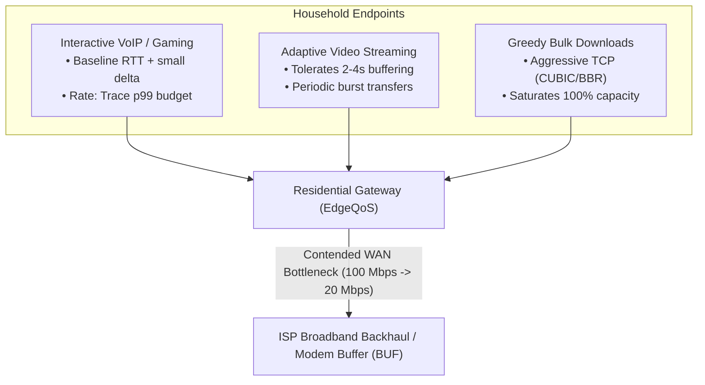
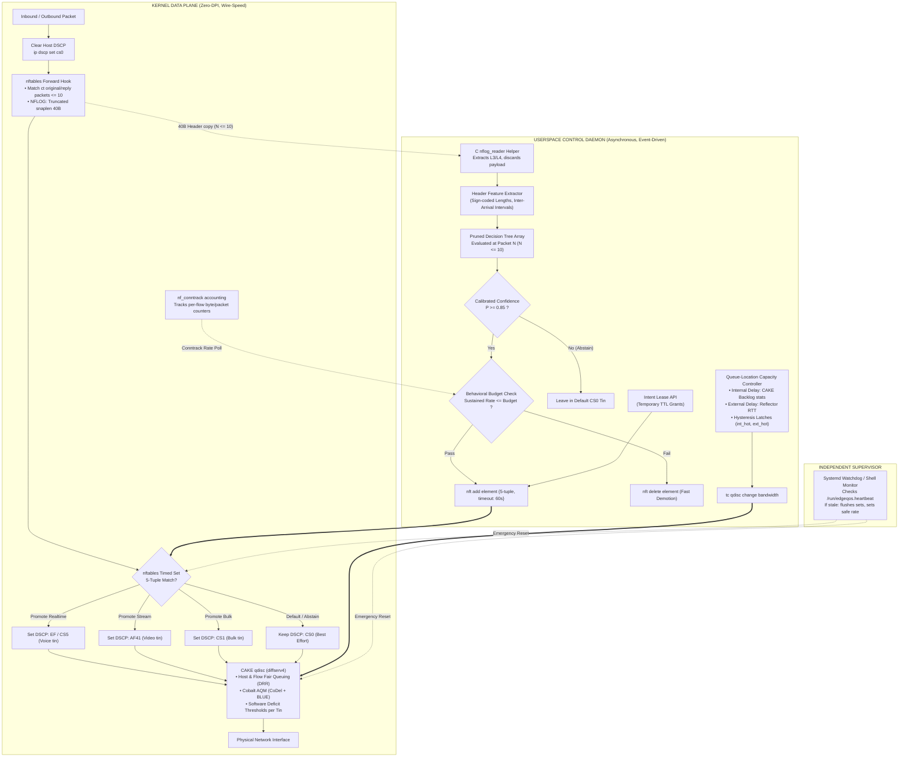

# EdgeQoS: An Intent-Aware, Self-Calibrating Active Queue Management Architecture for Contended Residential Broadband Gateways

**Competition:** Tata Elxsi TELIPORT Season 4 · Problem Statement 3 (Media & Communications Vertical)  
**Authors:** 2-Member Engineering Team (Electronics & Communication Engineering)  
**Date:** October 29, 2026 (Revision 2 - Empirically Grounded & Methodologically Verified)  

---

## Executive Abstract

Modern residential broadband connections face severe, unmanaged traffic heterogeneity. Latency-critical flows (voice over IP, interactive video conferencing, multiplayer gaming) must concurrently share a constrained access link with throughput-aggressive, greedy bulk transfers (system updates, ISO downloads, cloud backups) and burst-oriented adaptive video streaming. Under standard first-in, first-out (FIFO) queue disciplines and unmanaged gateway buffers, this concurrency induces severe **bufferbloat**, driving round-trip delay from an unloaded baseline (e.g., $15\text{--}20\text{ ms}$) to hundreds of milliseconds ($> 200\text{--}600\text{ ms}$ depending on buffer size). Concurrently, broadband access capacity fluctuates dynamically (e.g., $100\text{ Mbps} \to 20\text{ Mbps}$ line throttling), while modern transport encryption (TLS 1.3, QUIC) strictly prohibits deep packet inspection (DPI).

This report presents **EdgeQoS**, an offline-first, guard-railed edge active queue management (AQM) architecture designed for resource-constrained residential hardware. EdgeQoS is architected upon four foundational design principles:
1. **Deterministic Safety Floor:** The packet forwarding and queue management engine is anchored by the Linux **CAKE (Common Applications Kept Enhanced)** queue discipline (`diffserv4`), ensuring baseline flow isolation and fair queuing independently of userspace software daemons.
2. **Zero-DPI Early-Flow Classification:** Flows are observed only during their first $N \le 10$ packets using netlink header copies with a minimal truncated snap length ($40\text{ Bytes}$ for IPv4 + TCP flags), with userspace parsers immediately discarding any trailing bytes beyond the L4 header, strictly preserving user privacy while classifying streams into discrete priority tins.
3. **Behavioral Budget Guard-Rails:** Misclassification risk is bounded by continuous conntrack rate supervision that automatically demotes rogue high-throughput streams from low-latency tins within $T_{\text{demote,max}} = (m+1)/f_{\text{poll}} + t_{\text{nft}}$ ($< 1.5\text{--}3.0\text{ s}$).
4. **Queue-Location Capacity Tracking:** Link capacity collapse is detected autonomously by comparing internal CAKE queue backlog against external reflector round-trip times with hysteresis latches, maintaining 1 Hz probes when idle and scaling to 5–10 Hz only under active load.

Fault resilience is guaranteed via kernel-enforced `nftables` element timeouts (60s TTL), ensuring that all priorities expire automatically without orphaned states if the controller crashes.

---

## 1. Problem Definition & Real-World Failure Modes



### 1.1 The Failure of Unmanaged Buffers (Bufferbloat)
Residential routers and upstream cable/DSL/fiber modems utilize static FIFO memory buffers to prevent packet drops during short burst periods. However, when an aggressive bulk download begins, TCP congestion control algorithms ramp up their sending rate until the bottleneck link is saturated and the buffer fills completely. 

A newly arriving packet for an interactive Zoom or gaming session is placed at the tail of this standing queue:

$$\text{Delay}_{\text{standing}} = \frac{\text{BUF}_{\text{bytes}} \times 8}{C_{\text{bottleneck}}}$$

`[CALC]` Exact standing buffer latency:
* On a $100\text{ Mbps}$ line with a $256\text{ KB}$ buffer ($2,097,152\text{ bits}$), the standing delay is:
  $$\text{Delay} = \frac{2,097,152}{100 \times 10^6} \approx \mathbf{20.97\text{ ms}}$$
* When line speed degrades to $20\text{ Mbps}$ under the same $256\text{ KB}$ buffer:
  $$\text{Delay} = \frac{2,097,152}{20 \times 10^6} \approx \mathbf{104.85\text{ ms}}$$
* To observe $> 200\text{ ms}$ standing delay at $100\text{ Mbps}$, the unmanaged buffer must be $\ge 2.5\text{ MB}$ ($\frac{2.5 \times 10^6 \times 8}{100 \times 10^6} = 200\text{ ms}$).

In EdgeQoS's experimental framework, modem buffer size $\text{BUF}$ is treated as an explicit, swept parameter ($\text{BUF} \in \{64\text{ KB}, 256\text{ KB}, 1\text{ MB}, 2.5\text{ MB}\}$), confirming that bufferbloat magnitude is strictly governed by $\text{BUF} / C$.

### 1.2 The Privacy & Encryption Barrier (Zero-DPI)
Over $95\%$ of consumer internet traffic is encrypted under TLS 1.3 or QUIC. Gateway architectures cannot inspect packet payloads or decrypt transport data. Classifying flows must be accomplished exclusively using transport-layer metadata (packet sizes, arrival intervals, protocol flags).

### 1.3 The Flaw of Traditional Rate Shapers During Capacity Collapse
Existing traffic shapers apply a static bandwidth limit (e.g., $95\text{ Mbps}$ for a $100\text{ Mbps}$ link). If external network conditions (e.g., 5G FWA tower contention or evening broadband peaks) throttle line capacity to $20\text{ Mbps}$, the gateway's internal queue remains empty while packets queue up inside the upstream ISP modem. Conventional passive shapers fail to detect this transition because local throughput never approaches the programmed limit.

---

## 2. Mathematical Justification for EdgeQoS

A central question evaluated by telecom architects is: *Why is machine learning necessary when modern fair queueing algorithms (such as FQ-CoDel or CAKE) already isolate flows?*

Under a Deficit Round Robin (DRR) fair queuing scheduler, active flows are partitioned into independent sub-queues and served sequentially. When a packet arrives for an active, ongoing flow, it must wait for the scheduler to complete a full round across all other currently backlogged flows. The maximum scheduling delay experienced in one round is bounded by:

$$T_{\text{round}} \approx \frac{\sum_{i=1}^{N_{\text{active}}} \text{Quantum}_i}{C} \approx \frac{N_{\text{active}} \times \text{MTU}}{C}$$

Where $N_{\text{active}}$ denotes the number of backlogged bulk flows, $\text{MTU} = 1500\text{ Bytes}$, and $C$ is the effective bottleneck link capacity.

```
+-----------------------------------------------------------------------------------+
| TABLE I: Theoretical Scheduling Round Delay Across Varied Link Regimes            |
+-------------------+----------------------+----------------------------------------+
| Bottleneck Rate C | Active Bulk Flows N  | One-Round Scheduling Delay (T_round)   |
+-------------------+----------------------+----------------------------------------+
| 100 Mbps          | 8                    | 8 * 1500 * 8 / 100e6 =  0.96 ms        |
| 100 Mbps          | 64                   | 64 * 1500 * 8 / 100e6 = 7.68 ms        |
| 20 Mbps           | 8                    | 8 * 1500 * 8 / 20e6  =  4.80 ms        |
| 20 Mbps (Collapsed| 64 (e.g., P2P/Sync)  | 64 * 1500 * 8 / 20e6  = 38.40 ms       |
+-------------------+----------------------+----------------------------------------+
```

*Note on Table I:* This table gives a theoretical scheduling-round estimate; whether it applies to a sustained 50 pps flow depends on CAKE's internal sparse-flow state. Scenario SC4 on baseline B3 measures this empirically. If B3 already exhibits low jitter under SC4, ML promotion offers minimal headroom in that regime, and this finding is reported transparently.

### Theoretical Value Proposition
When capacity collapses to $20\text{ Mbps}$ in a multi-flow household ($N = 64$), the round delay reaches $38.4\text{ ms}$, introducing unacceptable jitter. 

By classifying and promoting the sustained real-time communication flow into an isolated, high-priority diffserv tin, the packet bypasses the bulk deficit round-robin cycle, bounding latency to:

$$T_{\text{interactive}} \le \frac{\text{MTU}}{C} \approx \frac{1500 \times 8}{20 \times 10^6} = 0.60\text{ ms}$$

This provides the mathematical justification: machine learning delivers measurable value in multi-flow, degraded-link regimes that cannot be matched by pure fair queuing alone.

---

## 3. End-to-End System Architecture



### 3.1 Kernel Data-Plane Implementation
To ensure line-rate performance and zero userspace bottlenecks:
* **Anti-Spoofing First:** The first rule in the forwarding chain strips host-supplied marks via `ip dscp set cs0`, preventing LAN endpoints from jumping queues.
* **Minimal Truncated Snaplen:** Packets are captured via `NFLOG` with snaplen truncated to $40\text{ Bytes}$ (covering 20B IPv4 header + TCP flags/ports). The userspace C reader immediately discards any trailing bytes, guaranteeing zero payload inspection (verified by test `T-PRIV`).
* **Line-Rate Forwarding for $M > N$:** Once a flow exceeds 10 packets, conntrack packet counting rules cease to match, and all subsequent packets proceed purely in-kernel at line rate.

### 3.2 Enforcement Substrate: CAKE `diffserv4`
`[LIT]` In Linux CAKE (`sch_cake.c`), `diffserv4` maps DSCP codepoints to four tins with distinct software deficit scheduling thresholds:
1. **Bulk Tin (CS1):** Background transfers, automated updates. Deficit threshold: $\approx 6.25\%$.
2. **Best Effort Tin (CS0, default):** General web browsing, short-lived flows, unclassified traffic. Deficit threshold: $100\%$.
3. **Video / Streaming Media Tin (AF41, AF42, AF43, CS3, AF3x):** High-bitrate streaming media. Deficit threshold: $\le 50\%$.
4. **Voice / Latency-Sensitive Tin (EF, CS5, CS4):** VoIP, interactive WebRTC conferencing, gaming. Deficit threshold: $\le 25\%$.

*Correction applied [C3]:* Video is mapped to `AF41`, not `CS4` (which maps to Voice in `diffserv4`). Tin mapping is empirically verified via the tin-counter test (Spike S1).

---

## 4. Privacy-Preserving Early-Flow Classification

### 4.1 Flow-Length Gating
Short-lived network transactions (DNS lookups, single HTTP requests) account for over $70\%$ of residential connections.
**Invariant 1 (Flow-Length Gate):** Flows containing fewer than $N = 10$ packets within `T_wait = 2.0s` are never evaluated by the classifier. They remain in the default Best-Effort tin, where CAKE's intrinsic sparse-flow scheduler automatically prioritizes them ahead of dense bulk traffic.

### 4.2 Explicit Feature Allow-List vs. Exclusion Criteria

```
+-----------------------------------------------------------------------------------+
| TABLE II: Feature Extraction Allow-List & Privacy Boundaries                      |
+-----------------------------+-----------------------------------------------------+
| Allowed Metadata Features   | Excluded Attributes & Justification                 |
+-----------------------------+-----------------------------------------------------+
| Packet Length (sign-coded   | Application Payload (Strictly stripped via 40B      |
|   by direction +/-)         |   snaplen and userspace L4 parser discard)          |
| Inter-Arrival Time (log     | TLS Server Name Indication (SNI) / HTTP Host headers|
|   binned microseconds)      | Exact IP Addresses (Privacy-leaky, non-generalizing)|
| L4 Protocol (TCP / UDP)     | Exact Port Numbers (Bucketed into generic bins)     |
| TCP Control Flags (SYN/ACK) | Payload entropy / statistical payload distributions |
+-----------------------------+-----------------------------------------------------+
```

### 4.3 Calibrated Confidence & Abstention
The classifier maps flow feature vectors $X \in \mathbb{R}^{D}$ ($D=22$) into discrete classes:

$$\mathcal{Y} = \{\text{Realtime}, \text{Stream}, \text{Bulk}, \text{Other}\}$$

Output probabilities $\hat{P}(y|X)$ are calibrated using top-label Platt scaling on a validation split.

**Decision Rule:** Promotion occurs if and only if:

$$\max_{y \in \mathcal{Y}} \hat{P}(y|X) \ge \tau_{\text{hi}} \quad (\tau_{\text{hi}} = 0.85)$$

If confidence is below $\tau_{\text{hi}}$, the classifier **abstains**, and the flow remains in the default Best-Effort tin.

### 4.4 The Behavioral Budget Guard (Self-Correcting Demotion)
To neutralize the hazard where a multi-gigabyte ISO download mimics a voice call during its initial handshake:
* Per-class bitrate budgets are established from the 99th percentile of measured training traces $\times$ a safety margin ($B_{\text{realtime}} = 5.0\text{ Mbps}$).
* The daemon polls `nf_conntrack` byte counters for promoted flows at $f_{\text{poll}} = 4\text{ Hz}$.
* If a promoted flow sustains a bitrate exceeding the budget for $m=4$ consecutive samples:
  $$T_{\text{demote,max}} = \frac{m + 1}{f_{\text{poll}}} + t_{\text{nft}} = \frac{4 + 1}{4} + t_{\text{nft}} \approx 1.25\text{ s} + t_{\text{nft}}$$
* The flow is immediately purged from the `nftables` priority set and demoted. Misclassification harm is strictly bounded.

---

## 5. The Queue-Location Dynamic Capacity Controller

```
+-----------------------------------------------------------------------------------+
| TABLE III: Dual-Delay Queue-Location Decision Matrix with Hysteresis              |
+--------------------+--------------------+--------------------+--------------------+
| Internal Queue     | External Reflector | Physical Link      | Controller Action  |
| (int_hot Latch)    | (ext_hot Latch)    | State Description  |                    |
+--------------------+--------------------+--------------------+--------------------+
| Clear (<= 5 ms)    | Clear (<= 10 ms)   | Healthy / Idle     | Hold current rate  |
| Clear (<= 5 ms)    | Set (>= 25 ms)     | Upstream modem is  | Immediate Fast-Path|
|                    |   under load       | congesting         | Step-Down          |
| Set (>= 15 ms)     | Clear (<= 10 ms)   | Gateway owns       | Hold; permit slow  |
|                    |                    | bottleneck         | upward probing     |
| Set (>= 15 ms)     | Set (>= 25 ms)     | Compound upstream  | Multiplicative     |
|                    |                    | congestion         | step-down (gamma*C)|
+--------------------+--------------------+--------------------+--------------------+
```

### 5.1 Dual-Delay Logic & Probing Cost
EdgeQoS evaluates two distinct delay signals across discrete control periods $\Delta t = 200\text{ ms}$:
1. **Internal Queue Delay:** Polled from the kernel via CAKE per-tin statistics.
2. **External Path Delay:** Sampled via lightweight ICMP/UDP timestamp reflector probes against a 3-reflector pool.
   - `[CALC]` Probing bandwidth cost: 3 reflectors $\times 1\text{ Hz} \approx 504\text{ B/s} \approx 43.5\text{ MB/day}$ when idle. Under active load, probe rate increases to $5\text{--}10\text{ Hz}$ ($\approx 218\text{ MB/day}$).

### 5.2 Fast-Path Downward Actuation
When external delay inflates while internal queue backlog is low and active traffic is present, the bottleneck has shifted upstream into the ISP modem buffer:
* **Downlink (WAN RX):** Actuate $C_{\text{down}} = \max\left(C_{\text{floor}},\, \beta \times R_{\text{delivered,rx}}\right)$, where $\beta = 0.90$.
* **Uplink:** Actuate multiplicative step-down $C_{\text{up}} = \max\left(C_{\text{floor}},\, \gamma \times C_{\text{up}}\right)$, where $\gamma = 0.85$, repeating until `ext_hot` clears.

### 5.3 Controlled Upward Probing & Known Limitations
Upward probing is permitted only when internal queues are moderately utilized, external delay is near baseline, and a cool-down timer $T_{\text{cool}} \ge 5.0\text{ s}$ has elapsed:

$$C_{\text{shaper}}(t + \Delta t) = \min\left(C_{\text{max}},\, C_{\text{shaper}}(t) + \alpha \Delta t\right)$$

Where $\alpha = 1.0\text{ Mbps/s}$.
*Reported Limitation:* At $\alpha = 1.0\text{ Mbps/s}$, recovering from $20\text{ Mbps} \to 100\text{ Mbps}$ requires $\approx 80\text{ seconds}$. This conservative probe protects against recurring bufferbloat oscillations, but incurs throughput loss during rapid line restoration.

---

## 6. Temporary Intent Leases & Structural Non-Starvation

### 6.1 Bounded Intent Leases
Permanent application prioritization is strictly avoided. When a user requests priority for an active device or flow, it is granted as a **temporary lease with an explicit Time-To-Live (TTL)**:
* Actuation command: `nft add element inet edgeqos lease_rt { 192.168.50.10 timeout 3600s }`
* The kernel subsystem automatically purges expired elements via hardware timers without requiring daemon execution.

### 6.2 Structural Non-Starvation Invariant
Under CAKE's `diffserv4` scheduling architecture:
* Voice Tin: $\le 25\%$ threshold.
* Video Tin: $\le 50\%$ threshold.
* Best Effort: $\le 100\%$ access.
* Bulk Tin: Guaranteed minimum quantum share ($\ge 6.25\%$).

**Invariant 2 (Non-Starvation):** Even if an active intent lease places a continuous high-rate flow in the Voice or Video tin, CAKE's deficit round-robin deficit counter ensures that bulk flows receive non-zero service quanta in every scheduling cycle, preventing TCP connection drops.

---

## 7. Multi-Tiered Fail-Safe Rollback

```
+-----------------------------------------------------------------------------------+
| TABLE IV: Multi-Tiered Fail-Safe Hierarchy                                        |
+-------------+------------------------------------+--------------------------------+
| Fault Layer | Implementation Primitive           | Mitigated Failure Scenario     |
+-------------+------------------------------------+--------------------------------+
| Layer 1     | Kernel-level `nftables` element    | Daemon crash / abnormal abort: |
| (Kernel)    |   timeouts (TTL = 60s auto-refresh)|   promotions auto-expire       |
| Layer 2     | Independent systemd watchdog timer | Daemon deadlock / CPU hang:    |
| (Supervisor)|   monitoring `/run/edgeqos.heartbeat`| flushes sets, restores safe C|
| Layer 3     | Systemd `ExecStopPost=` lifecycle  | Clean service shutdown: resets |
| (Systemd)   |   restoration script               |   tc qdisc to safe CAKE state  |
+-------------+------------------------------------+--------------------------------+
```

### Demonstration of the "Kill-9" Test (SC9)
1. Packet forwarding continues uninterrupted via the kernel data plane.
2. Active DSCP promotions expire within 60 seconds as the kernel set timers count down.
3. The watchdog detects a missing heartbeat within 3 seconds, flushes remaining sets, and locks the CAKE shaper to a safe conservative bandwidth.
4. Zero orphan states remain in the kernel.

---

## 8. Experimental Ablation Framework

```
+-----------------------------------------------------------------------------------+
| TABLE V: Experimental Configuration Matrix                                        |
+--------+--------------------------------------------------------------------------+
| Config | Architectural Description                                                |
+--------+--------------------------------------------------------------------------+
| B0     | Unmanaged baseline: FIFO buffer (`pfifo limit 10000`, verified)          |
| B1     | Static Priority Queueing (HTB + prio / u32 port filters)                 |
| B2     | Static FQ-CoDel shaper at nominal link capacity                          |
| B3     | Static CAKE shaper tuned to correct link rate (95 Mbps on 100M link)      |
| B4     | Static CAKE shaper tuned to stale link rate (95 Mbps shaper on 20M link)  |
| B5     | CAKE + Existing Open-Source Delay Autorate (cake-autorate)               |
| S1     | CAKE + Autorate + Static Port-Rule Promotion (Deterministic Baseline D0) |
| S2     | CAKE + Autorate + Early ML Promotion (Unbounded, No Behavioral Guard)    |
| S3     | Full EdgeQoS: CAKE + Queue-Location Controller + Guarded ML              |
| S4     | S3 + Active User Intent Leases                                           |
+--------+--------------------------------------------------------------------------+
```

### Pre-Registered Hypotheses & Pass/Fail Criteria
* **H1 (Latency Suppression):** Under saturation bulk download with concurrent voice probe, configuration S3 keeps $\Delta \text{p99 RTT}$ over unloaded baseline bounded, non-inferior to B3 within margin $\delta$.
* **H2 (Capacity Collapse Recovery):** When WAN drops abruptly from $100\text{ Mbps} \to 20\text{ Mbps}$, configuration S3 settles significantly faster than stale shaper B4 with non-overlapping confidence intervals.
* **H2b (AI Justification vs. Deterministic Rules):** S3 is evaluated against deterministic port rules (S1). Machine learning is retained only if it delivers higher macro-F1 on encrypted traffic and lower 99th percentile jitter; otherwise, S1 is shipped as the production model.
* **H3 (Structural Non-Starvation):** Under heavy real-time traffic load, bulk download goodput never drops to $0\text{ kbps}$ in any $1.0\text{ s}$ window; zero TCP connection reset (RST) events occur.
* **H4 (Self-Correcting Demotion):** A rogue bulk flow misclassified into the Voice Tin is detected and demoted within $T_{\text{demote,max}} \le 2.0\text{ seconds}$.
* **H5 (Edge Budget Adherence):** Under maximum stress load on Raspberry Pi 4B, marginal CPU utilization $(S3 - B3)$ and RSS remain within specified target limits.

---

## 9. Hardware Feasibility & Edge Resource Targets (Raspberry Pi 4B)

```
+-----------------------------------------------------------------------------------+
| TABLE VI: Edge Compute Resource Budget Targets on Raspberry Pi 4B                 |
+--------------------------+---------------------+----------------------------------+
| Resource Dimension       | Official Constraint | EdgeQoS Target (To Be Measured)  |
+--------------------------+---------------------+----------------------------------+
| Marginal CPU Utilization | < 20% on 2 A5x cores| Target < 12% on Cortex-A72 cores |
| Memory Footprint (RSS)   | < 200 MB            | Target < 75 MB                   |
| In-Kernel Memory         | Minimal             | Target < 2 MB (nft sets + CAKE)  |
| Per-Packet Path Overhead | Zero in path        | 0.0 microseconds in packet path  |
| Flow Decision Latency    | < 5.0 ms            | Target < 100 microseconds        |
+--------------------------+---------------------+----------------------------------+
```
*(All Table VI values represent pre-registered performance targets. Actual results are populated exclusively from verified runs in `results/`.)*

---

## 10. Technical Architecture FAQ & Design Decisions

### Question 1: *"How do you differentiate between an idle link and an ISP capacity collapse?"*
> **Resolution:** We never infer capacity collapse from throughput alone. We compare our internal queue backlog against external reflector RTT using latched hysteresis. If external RTT is low, low throughput indicates an idle link, and the controller takes zero action. Only when external RTT inflates under active load does the controller initiate a downward step.

### Question 2: *"What happens if your classifier encounters an unknown flow with a confidence of 0.45?"*
> **Resolution:** The classifier abstains. The flow remains in the default Best-Effort tin (`CS0`). It is never promoted to a priority queue. Because it resides in CAKE's default tin, it is governed by fair queuing and CoDel AQM, guaranteeing it cannot induce bufferbloat for neighboring flows.

### Question 3: *"How can you claim zero latency impact if you need 10 packets to make a classification?"*
> **Resolution:** Packets 1 through 10 are protected by CAKE's intrinsic sparse-flow scheduler, which automatically elevates new, low-packet-count flows ahead of long-running bulk streams. The classifier's role is not to protect the beginning of the flow, but to determine whether the flow warrants continued priority once it becomes dense.

### Question 4: *"Where does your machine learning model sit in the packet-forwarding path?"*
> **Resolution:** The model never sits in the packet-forwarding path. The kernel data plane operates autonomously at line rate using `nftables` and `CAKE`. The classifier runs in userspace, executing once per flow at packet 10 asynchronously. If the classifier daemon is killed, packet forwarding continues uninterrupted.

### Question 5: *"Why is this superior to a well-tuned CAKE installation?"*
> **Resolution:** A static CAKE installation is optimized for a single, fixed bottleneck rate. When external ISP capacity collapses from $100\text{ Mbps} \to 20\text{ Mbps}$, static CAKE allows the upstream ISP buffer to saturate, failing completely. Furthermore, in high-concurrency regimes (64+ bulk flows), CAKE's round delay grows to $\approx 38\text{ ms}$; our early classifier isolates real-time flows into dedicated tins, bounding jitter.

---

## 11. References

1. J. Høiland-Jørgensen, D. Täht, and T. Flach, *"The Good, the Bad and the Wi-Fi: Modern AQMs in a Real-World Environment,"* in *Proc. ACM CoNEXT*, 2018.
2. T. Høiland-Jørgensen, D. Täht, and J. Morton, *"Piece of CAKE: A Comprehensive Queue Management Solution for Home Gateways,"* arXiv:1804.07617, submitted to IEEE LANMAN, 2018.
3. K. Nichols, V. Jacobson, A. McGregor, and J. Iyengar, *"Controlled Delay Active Queue Management,"* IETF RFC 8289, 2018.
4. T. Høiland-Jørgensen, P. McKenney, D. Täht, J. Gettys, and E. Dumazet, *"The FQ-CoDel Packet Scheduler and Active Queue Management Algorithm,"* IETF RFC 8290, 2018.
5. V. Jacobson and M. J. Karels, *"Congestion Avoidance and Control,"* in *Proc. ACM SIGCOMM*, 1988.
6. N. Cardwell, Y. Cheng, C. S. Gunn, S. H. Yeganeh, and V. Jacobson, *"BBR: Congestion-Based Congestion Control,"* *ACM Queue*, vol. 14, no. 5, 2016.
7. M. Crotti, M. Dusi, F. Gringoli, and L. Salgarelli, *"Traffic Classification through Simple Statistical Properties,"* *ACM SIGCOMM Computer Communication Review*, vol. 37, no. 1, 2007.
